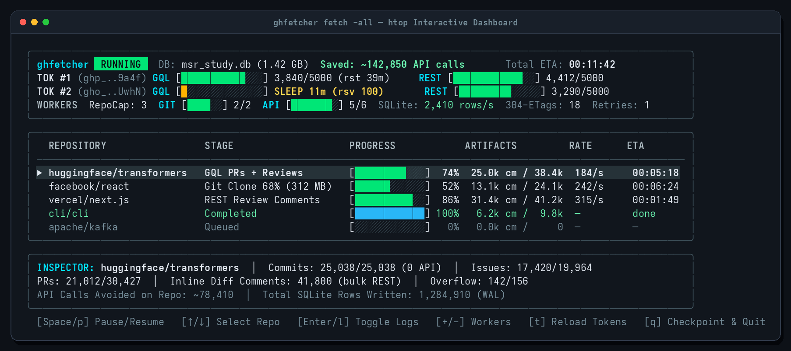
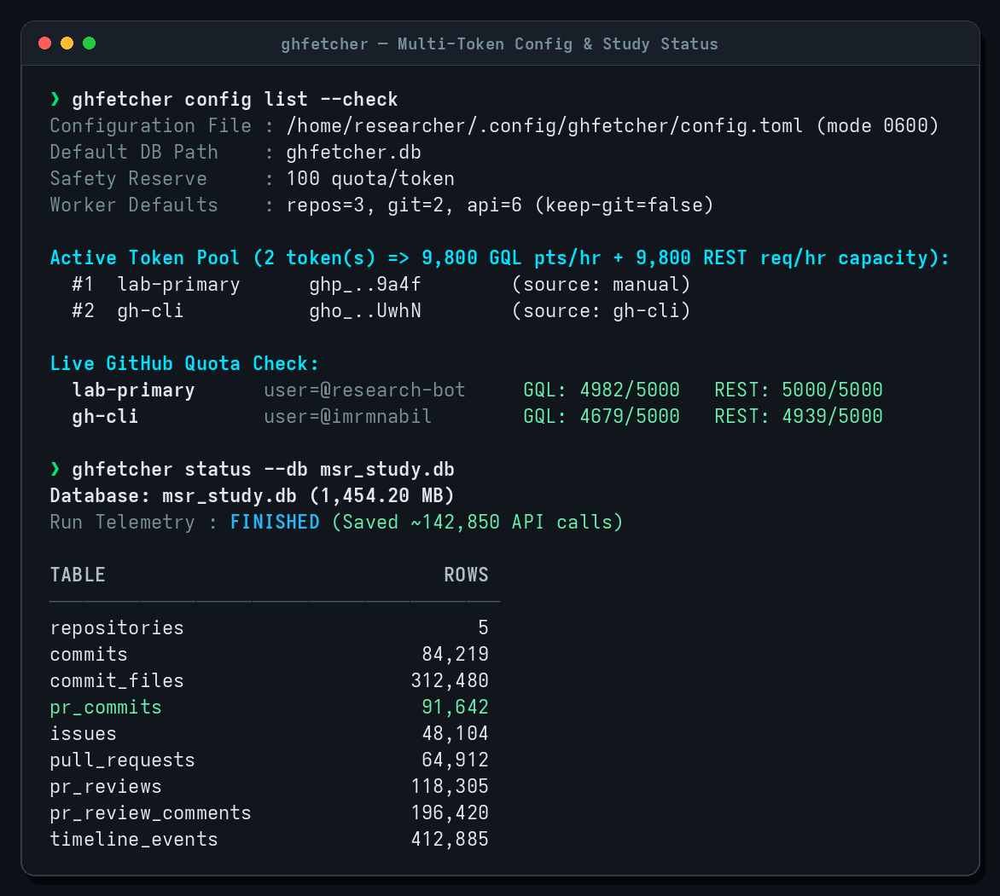
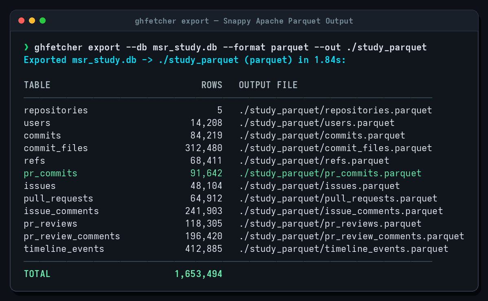

<div align="center">

# `ghfetcher`

**Ultra-efficient GitHub artifact miner for MSR & empirical software engineering research.**

[](https://github.com/imrmnabil/github-artifact-fetcher/releases)
[](https://github.com/imrmnabil/github-artifact-fetcher/actions)
[](https://go.dev/)
[](LICENSE)

*Zero-API bare Git extraction · Dual-pool GraphQL + REST scheduling · Multi-token load balancing · `htop`-style TUI · SQLite WAL & Apache Parquet*

</div>

---

<p align="center">
  
</p>

## Why `ghfetcher`?

Mining GitHub repositories for research (commits, line churn, pull requests, issues, code reviews, inline diff comments, reactions, and timeline events) normally burns through hourly API limits in minutes. **`ghfetcher` cuts API calls by 90–99%** without sacrificing data completeness:

| Artifact *(example: 25k commits, 4k PRs, 3k issues, 24k comments)* | Naive REST Crawler | Pure GraphQL Crawler | `ghfetcher` Hybrid + Bare Git |
| :--- | ---: | ---: | ---: |
| Commits, messages & per-file `+add/-del` churn | ~25,250 calls | ~500+ pts *(no churn)* | **0 API calls** *(ephemeral bare Git)* |
| PR → Commit SHA mappings *(incl. closed/unmerged PRs)* | 4,000 calls | ~80 pts | **0 API calls** *(`+refs/pull/*/head`)* |
| Issues, PRs, labels, reviews, reactions & timeline | ~19,000 calls | ~160 pts | **~110 GQL pts** *(4-stream parallel)* |
| Inline PR diff comments + discussion comments | ~7,000 calls | ~200 pts | **~240 REST calls** *(repo-wide 100/call + 304 ETag)* |
| **Total Quota Consumed** | **~55,250 calls** | **~940 pts** | **~110 GQL pts + ~240 REST calls** |

### Key Highlights
- **Zero-API 2-Step Bare Git Pipeline**: Fetches branches/tags full for offline `--numstat` line churn (and optional `--patches`), fetches `+refs/pull/*/head` **blobless** (`--filter=blob:none`) so 30k+ PR refs download in seconds, links PRs to commits in Go memory, then auto-deletes temp `.git` dirs.
- **Dual-Pool Multi-Token Scheduler**: Uses every token's **5,000 GraphQL pts/hr** AND **5,000 REST req/hr** simultaneously with a configurable **100-quota safety reserve**, automatic secondary rate-limit rotation, and non-blocking offline Git extraction during API cooldowns.
- **Crash-Resumable SQLite WAL + Columnar Parquet**: Every page commits atomically alongside `_sync_checkpoints`—stop anytime with `q` / `Ctrl+C` and resume cleanly later. Export all 12 normalized tables to Snappy **Apache Parquet** or **JSONL** in seconds.
- **Remote Server Friendly (`--no-tui` + `attach`)**: Run headless under `nohup` / `tmux` over SSH and attach the live `htop` dashboard anytime via `ghfetcher attach --db study.db`.

---

## Installation

### Linux & macOS (Recommended One-Liner)
Downloads the latest release binary and verifies its SHA256 checksum automatically:

```bash
curl -fsSL https://raw.githubusercontent.com/imrmnabil/github-artifact-fetcher/main/install.sh | sh
```

### Windows & Manual Downloads
Grab pre-built archives for Linux (`amd64`, `arm64`), macOS (`amd64`, `arm64`), and Windows (`amd64`) from [GitHub Releases](https://github.com/imrmnabil/github-artifact-fetcher/releases).

### Build from Source (Go 1.24+)

```bash
git clone https://github.com/imrmnabil/github-artifact-fetcher.git
cd github-artifact-fetcher
CGO_ENABLED=0 go build -o ghfetcher ./cmd/ghfetcher
```

---

## Quick Start

### 1. Configure Your Token Pool (`ghfetcher config`)

```bash
# Interactive TUI wizard (writes chmod 0600 ~/.config/ghfetcher/config.toml)
ghfetcher config

# Or scriptable CLI commands (ideal for headless SSH servers)
ghfetcher config import-gh                  # Import from `gh auth token`
ghfetcher config add-token --label lab-pat  # Add additional PATs to multiply hourly throughput
ghfetcher config list --check               # Verify live REST & GraphQL balances
```

<p align="center">
  
</p>

### 2. Fetch All Research Artifacts (`ghfetcher fetch -all`)

```bash
# Interactive htop-style dashboard
ghfetcher fetch -all facebook/react vercel/next.js --out msr_study.db

# Batch corpus from a file (with full unified commit diffs)
ghfetcher fetch -all --patches --from repos.txt --out corpus.db

# Headless SSH server execution + live remote TUI attach
nohup ghfetcher fetch -all huggingface/transformers --out hf.db --no-tui > fetch.log 2>&1 &
ghfetcher attach --db hf.db
```

### 3. Export to Apache Parquet or JSONL (`ghfetcher export`)

```bash
ghfetcher export --db msr_study.db --format parquet --out ./study_parquet
ghfetcher export --db msr_study.db --format jsonl   --out ./study_jsonl
```

<p align="center">
  
</p>

---

## Documentation

Detailed guides live in the [`docs/`](docs/) directory:

| Guide | What's Inside |
| :--- | :--- |
| **[Architecture & Efficiency](docs/architecture.md)** | 2-step bare Git pipeline, in-memory PR→SHA DAG linker, dual-pool token scheduler, 4-stream parallel GraphQL, and cooldown continuation |
| **[CLI & TUI Reference](docs/cli-reference.md)** | Complete command/flag reference, environment variables, `config.toml` defaults, and `htop` TUI keybindings |
| **[Database & Parquet Schema](docs/schema.md)** | ER diagram and full column reference for all 12 normalized research tables + internal checkpoint/cache tables |
| **[Research Query Recipes](docs/research-queries.md)** | Ready-to-run SQL, DuckDB, and Python queries for review latency, commit churn, hotspot files, and force-push studies |

---

## License

Released under the [MIT License](LICENSE).
