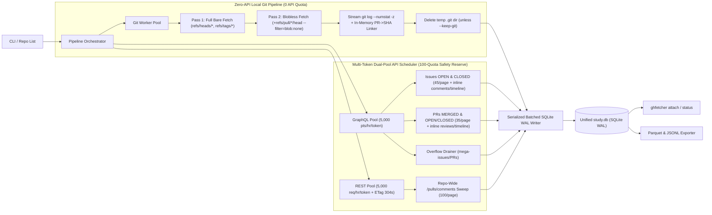

# Architecture & Efficiency Design

`ghfetcher` is engineered specifically to minimize GitHub API quota burn while mining complete, relational software engineering datasets.

---

## High-Level Data Flow

---

## Five Core Efficiency Pillars

### 1. Two-Step Ephemeral Bare Git Extraction (`0 API Cost`)
Fetching commits, line churn, and PR commit lists via GitHub's API is the #1 source of rate-limit exhaustion. `ghfetcher` bypasses the API completely via the Git wire protocol:

1. **Pass 1 (Full Branches & Tags)**: Fetches `+refs/heads/*:refs/heads/*` and `+refs/tags/*:refs/tags/*` with full blobs so `git log --branches --tags --numstat -z` computes exact per-file `+additions/-deletions` (and optional `--patches`) 100% offline in constant ~30 MB RAM.
2. **Pass 2 (Blobless PR Refs)**: Fetches `+refs/pull/*/head:refs/pull/*/head` with `--filter=blob:none`. Even on repositories with 30,000+ PRs, downloading commit/tree headers without abandoned PR file blobs completes in seconds.
3. **In-Memory PR→Commit DAG Linker**: Walks the commit parent graph in Go memory (`< 50ms`, zero extra `git` subprocesses) to map every PR—open, merged, squash-merged, or closed—to its exact constituent commit SHAs in `pr_commits`.
4. **Ephemeral Disk Cleanup**: Temp `.git` folders are deleted immediately after SQLite flush. Incremental re-runs use `--shallow-since` to fetch only recent history.

### 2. Independent Dual-Bucket Token Scheduling (`2x Quota / Token`)
Every GitHub Personal Access Token has **two separate hourly quotas**:
- **5,000 GraphQL points/hr**
- **5,000 REST requests/hr**

`internal/tokenpool` tracks both buckets independently per token, balances across `N` pooled tokens (preferring tokens whose hourly window resets soonest to maximize cluster yield), enforces a configurable **100-quota safety reserve** per bucket so personal tokens never lock out daily `gh`/IDE workflows, and automatically rotates past secondary rate limits (`403`/`429` + `Retry-After`).

### 3. State-Partitioned Parallel GraphQL Streams
For a single large repository, sequential cursor pagination (`after: $cursor`) limits throughput to 1 request at a time. `ghfetcher` splits each repository into **4 concurrent GraphQL streams**:
- `gql_issues_open` (`states: [OPEN]`, 45/page)
- `gql_issues_closed` (`states: [CLOSED]`, 45/page)
- `gql_prs_merged` (`states: [MERGED]`, 35/page)
- `gql_prs_other` (`states: [OPEN, CLOSED]`, 35/page)

Each page bundles labels, assignees, milestones, reactions, closing references, and the first slice of comments, reviews, and timeline events inline. Only mega-items returning `hasNextPage: true` enqueue follow-up `OverflowTask` pages.

### 4. Repo-Wide REST Bulk Sweeps + Free `304` `ETag` Caching
Instead of issuing per-PR requests for inline code-review diff comments, the REST pool sweeps `GET /repos/{owner}/{repo}/pulls/comments?sort=updated&direction=asc&per_page=100` across the entire repository at **100 comments per call** while storing `ETag` headers in `_etag_cache`. Unchanged pages return `304 Not Modified` at **0 quota cost**.

### 5. Non-Blocking Offline Work During Quota Cooldowns & Crash Safety
- If all API tokens hit their safety reserve, API workers sleep until `min(reset_at)` and auto-resume—while **local Git clone and churn-indexing workers continue uninterrupted**.
- Every ingestion batch commits artifacts and `_sync_checkpoints` in a **single atomic SQLite WAL transaction**. Pressing `q`/`Ctrl+C` (killing the entire `git` process group cleanly via `Setpgid`) or losing power never duplicates or corrupts rows.
