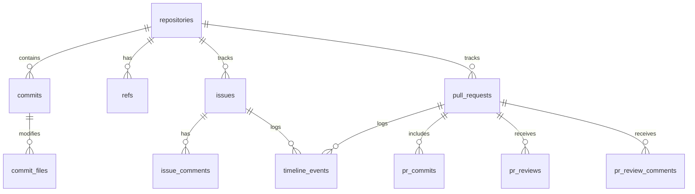

# Database & Parquet Schema

`ghfetcher` writes to a normalized **SQLite (WAL mode)** database where every artifact table is keyed by `repo_id` (foreign key to `repositories.id`), enabling cross-repository joins out of the box. Running `ghfetcher export --format parquet` exports the exact same 12 tables with identical column names and Snappy compression.

---

## Entity Relationship Overview

---

## Research Artifact Tables (Exported to Parquet / JSONL)

### 1. `repositories`
| Column | Type | Description |
| :--- | :--- | :--- |
| `id` | `INTEGER PK` | Internal repository surrogate key |
| `github_id` | `INTEGER` | GitHub numeric repository ID |
| `owner`, `name`, `full_name` | `TEXT` | Owner, repo name, lowercase unique `owner/name` |
| `default_branch` | `TEXT` | Default branch name (e.g. `main`) |
| `is_fork`, `stars`, `forks`, `disk_kb` | `INTEGER` | Repository metadata & bare size estimate |
| `total_commits_est`, `total_issues_est`, `total_prs_est` | `INTEGER` | Pre-flight counts from GitHub GraphQL |
| `cloned_head_sha`, `last_commit_at`, `last_synced_at` | `TEXT` | Sync watermarks (RFC3339 UTC) |

### 2. `users`
| Column | Type | Description |
| :--- | :--- | :--- |
| `login` | `TEXT PK` | GitHub username |
| `github_id` | `INTEGER` | GitHub numeric user ID |
| `name`, `email`, `type` | `TEXT` | Profile name, public email, `User` / `Bot` / `Organization` |

### 3. `commits` *(Extracted via Zero-API Bare Git)*
| Column | Type | Description |
| :--- | :--- | :--- |
| `repo_id`, `sha` | `PK` | Repository ID + 40-char commit SHA |
| `author_name`, `author_email`, `authored_at` | `TEXT` | Git author metadata (RFC3339) |
| `committer_name`, `committer_email`, `committed_at` | `TEXT` | Git committer metadata (RFC3339) |
| `message` | `TEXT` | Full commit message (subject + body) |
| `parents_json` | `TEXT` | JSON array of parent commit SHAs |
| `files_changed`, `additions`, `deletions` | `INTEGER` | Aggregated `--numstat` churn metrics |

### 4. `commit_files` *(Extracted via Zero-API Bare Git)*
| Column | Type | Description |
| :--- | :--- | :--- |
| `repo_id`, `commit_sha`, `file_path` | `PK` | File modified in a commit |
| `old_path`, `change_type` | `TEXT` | Previous path on renames (`R`) or `M` |
| `additions`, `deletions` | `INTEGER` | Line-level churn (`0` for binary files) |
| `patch` | `TEXT` | Unified diff patch (populated when `--patches` is enabled) |

### 5. `refs` & 6. `pr_commits` *(Extracted via Zero-API Bare Git)*
- **`refs`**: `(repo_id, ref_name)` PK, `target_sha`, `ref_type` (`branch`, `tag`, `pr_head`).
- **`pr_commits`**: `(repo_id, pr_number, commit_sha)` PK, `ordinal` (`1..N` oldest to PR head). Built in memory from `+refs/pull/*/head` parent DAG traversal.

### 7. `issues`
`(repo_id, number)` PK, `github_id`, `state`, `state_reason`, `title`, `body`, `author_login`, `milestone`, `labels_json`, `assignees_json`, `comment_count`, `reactions_json`, `created_at`, `updated_at`, `closed_at`.

### 8. `pull_requests`
`(repo_id, number)` PK, `github_id`, `state`, `is_draft`, `merged`, `title`, `body`, `author_login`, `merged_by_login`, `base_ref`, `base_sha`, `head_ref`, `head_sha`, `merge_commit_sha`, `additions`, `deletions`, `changed_files`, `comment_count`, `review_count`, `labels_json`, `assignees_json`, `closing_issues_json`, `reactions_json`, `created_at`, `updated_at`, `closed_at`, `merged_at`.

### 9. `issue_comments`
`(repo_id, comment_id)` PK, `item_number`, `is_pr` (`0`/`1`), `author_login`, `body`, `reactions_json`, `created_at`, `updated_at`.

### 10. `pr_reviews`
`(repo_id, review_id)` PK, `pr_number`, `author_login`, `state` (`APPROVED`, `CHANGES_REQUESTED`, `COMMENTED`, `DISMISSED`), `commit_sha`, `body`, `submitted_at`.

### 11. `pr_review_comments` *(Inline Diff Comments via Bulk REST)*
`(repo_id, comment_id)` PK, `pr_number`, `review_id`, `in_reply_to_id`, `author_login`, `path`, `commit_sha`, `original_commit_sha`, `diff_hunk`, `line`, `start_line`, `side`, `body`, `reactions_json`, `created_at`, `updated_at`.

### 12. `timeline_events`
`(repo_id, event_key)` PK, `item_number`, `is_pr`, `event_type` (`LabeledEvent`, `AssignedEvent`, `ClosedEvent`, `ReopenedEvent`, `MergedEvent`, `ReviewRequestedEvent`, `HeadRefForcePushedEvent`, `RenamedTitleEvent`, `CrossReferencedEvent`), `actor_login`, `payload_json`, `created_at`.

---

## Internal Operational Tables (Not Exported)
- `_sync_checkpoints`: Atomic per-stream cursors, `updated_at` watermarks, and completion flags for crash recovery & incremental sync.
- `_etag_cache`: Stored REST `ETag` values for zero-quota `304 Not Modified` responses.
- `_runtime_telemetry` / `_runtime_commands`: Live IPC channel powering `ghfetcher attach` and `ghfetcher status`.
